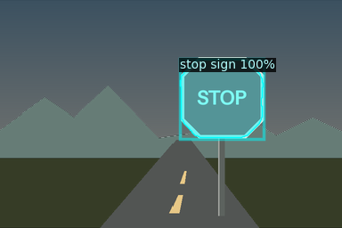

# EagleEye

**Upload a local image, inspect COCO object predictions, and download an annotated PNG.** EagleEye is a small Streamlit front end for Detectron2's CPU Mask R-CNN model.

## Try it

The repository's Dockerfile is the reference Linux/amd64 setup. It uses Python 3.8 and PyTorch 1.8 CPU, an older stack; use a local container rather than treating this setup as a production deployment. On Windows, switch Docker Desktop to Linux containers.

```bash
git clone https://github.com/BetoBraga/eagle-eye.git
cd eagle-eye
docker build -t eagle-eye:local .
docker run --rm -p 127.0.0.1:8501:8501 eagle-eye:local streamlit run app.py --server.address 0.0.0.0 --server.headless true
```

1. Open [localhost:8501](http://localhost:8501).
2. Upload [the synthetic stop-sign fixture](demo/synthetic-stop-sign.png), or a local PNG/JPG/JPEG of your own. The first prediction can download the public Detectron2 weights. Allow egress to the model host if the weights are not already cached.
3. Check the displayed labels and masks, then use **Download Annotated Image** to save `output.png`.

For a native install, follow [Detectron2's compatibility matrix](https://detectron2.readthedocs.io/en/latest/tutorials/install.html) and install the matching PyTorch/torchvision pair before Detectron2. Install Streamlit, OpenCV (headless), and Pillow in the same environment, then run `python -m streamlit run app.py --server.headless true`. Do not assume the Dockerfile's archived wheel works on native Windows or a recent Python.

## Example and reproducibility

| Synthetic input | Actual Detectron2 output |
| :--- | :--- |
|  |  |

This 384 × 256 input was drawn for EagleEye with no source imagery. [The generator](demo/make_fixture.py) creates it with Pillow. The fixture PNG may be freely copied and redistributed. This does not change the licensing of the app, weights, or historic demo files.

The checked-in output was generated in the repository's Linux/amd64 Docker image (Python 3.8, PyTorch 1.8 CPU, Detectron2 0.6 CPU). This run returned one detection: stop sign, confidence 0.9990. The result is a single synthetic fixture, not benchmark evidence. Reproduce the app's inference and rendering path without the browser by running:

```bash
docker run --rm eagle-eye:local python demo/run_fixture.py demo/synthetic-stop-sign.png /tmp/eagleeye-annotated.png
```

This prints the detected class names and confidence scores and writes a PNG inside the container, which is removed on exit. To keep the image, create an empty local output directory and bind-mount it, then pass a path inside that mount instead of `/tmp/eagleeye-annotated.png`.

## How it works

- [`app.py`](app.py) decodes uploads with OpenCV, runs pretrained COCO Mask R-CNN R50-FPN on CPU, and filters predictions below **0.50** confidence.
- The output renders the detections found by the model. An empty result is possible; the model may miss objects or assign the wrong label. The app does not recognize arbitrary classes or train a model.
- With the loopback Docker command, the browser connects to the container on your own machine and the app itself does not intentionally send the uploaded image to any third-party API. The dependency installation and uncached model weight download require network access.
- [`Dockerfile`](Dockerfile) defines the Linux CPU image. [`demo/run_fixture.py`](demo/run_fixture.py) runs the same model setup and visualization code as the app.

Upstream projects: [Detectron2](https://github.com/facebookresearch/detectron2), [Streamlit](https://github.com/streamlit/streamlit), and [COCO](https://cocodataset.org/).
